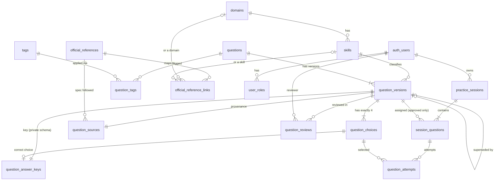

# SATLab Question Engine — Consolidated Database Specification

**Milestone 2 deliverable · Version 1.0-draft · 2026-11-19**
**Status:** Architecture approved by the project owner. This document and the nine SQL migration drafts are **awaiting owner review**. Nothing has been applied to any database, and **none of the SQL has been executed or syntax-checked against a PostgreSQL server** by the author (no server was available). The first real validation is `supabase db reset` on a local stack (Milestone 3).

---

## 1. Purpose, scope and tiers

SATLab is evolving into a Hybrid Question Engine: independently authored (AI or human) questions that follow public SAT specifications, plus *links* to official resources. **No College Board question text is stored or paraphrased.** "Human-reviewed" is a review status, not a source.

**MVP scope = Question Bank + Practice only.** Standard Test and Adaptive Simulation are Future; the schema leaves extension points but implements none of them.

| Tier | Meaning | Tables |
|---|---|---|
| **Foundation** (4) | Security and governance; must exist from the first migration | `user_roles`, `private.question_answer_keys`, `question_sources`, `question_reviews` |
| **MVP** (12) | Product data for the Question Bank and Practice | `domains`, `skills`, `questions`, `question_versions`, `question_choices`, `tags`, `question_tags`, `official_references`, `official_reference_links`, `practice_sessions`, `session_questions`, `question_attempts` |
| **Future** | Additive, not in Milestone 3 | `question_assets`; `private.question_accepted_answers` (student-produced response); test templates/modules/routing; Test/Adaptive columns; stats views; validation reports; audit log; exact-position resume (`last_item_order`); marked-for-review; historical question review |

Foundation + MVP = **16 tables** = migration set 1 (migrations 0001–0009).

## 2. Roadmap reconciliation and deviations

### 2.1 Roadmap reconciliation (provisional)

The original SATLab roadmap file **was not present in the conversation** in which these drafts were produced (only the continuation brief was received). The assistant therefore could **not** compare the design against the roadmap text. The owner has stated that they compared the architecture with the roadmap themselves. What *could* be reconciled is the six-table list quoted in the brief:

| Roadmap table | In this design | Difference |
|---|---|---|
| `questions` | `questions` + `question_versions` | Identity and content split (needed for versioning, auditability and attempts pinned to exact content) |
| `question_choices` | `question_choices` | **No correctness flag**; the key is private (security requirement) |
| `question_sources` | `question_sources` | 1:1 with a *version*; links to `official_references` |
| `question_reviews` | `question_reviews` | Append-only; decisions `approved`/`rejected`/`withdrawn`; originality confirmation |
| `question_attempts` | `question_attempts` + `practice_sessions` + `session_questions` | Sessions and items added for navigation, retries and future Test Mode |
| `question_tags` | `tags` + `question_tags` | Proper tag table; tags attach to questions, not versions |

**Added beyond the six roadmap tables:** `domains`, `skills`, `user_roles`, `official_references`, `official_reference_links`, `private.question_answer_keys`, `practice_sessions`, `session_questions`.

**Owner action (open):** compare against the roadmap file and record any further difference below as a written amendment (A1, A2, …). Until then reconciliation is *not* complete.

### 2.2 Deviations introduced while drafting the SQL (please confirm or reject)

| # | Deviation from the previously presented design | Reason |
|---|---|---|
| D1 | The composite FK `question_answer_keys_correct_choice_fk` is `ON DELETE NO ACTION` as approved, but also **`DEFERRABLE INITIALLY DEFERRED`** | Deleting a draft version cascades to both its choices and its key; an *immediate* NO ACTION check can fire before the key row is cascade-deleted and wrongly fail. Deferring to commit time keeps the rule and fixes the cascade. Consequence: a bad key is reported at commit; tests use `set constraints … immediate`. |
| D2 | `create_session` and `create_draft_version` return a **JSON object**, not a table row | Avoids PL/pgSQL name clashes between OUT columns and table columns; same content |
| D3 | "Command of Evidence" is modelled as **two skills** (Textual, Quantitative) → 30 skills | College Board lists the two sub-skills under it; owner may prefer one skill |
| D4 | `create_draft_version` **rejects** `tag_slugs` for an existing question (`invalid_payload`) | Tags belong to the question; silently ignoring them would hide mistakes |
| D5 | `question_reviews` also blocks **TRUNCATE**; version deletion is blocked for non-drafts by the lifecycle trigger (in addition to FK RESTRICT) | Defence in depth for the audit trail |
| D6 | Error codes are plain message strings (e.g. `item_not_found`) | Needed a concrete convention; frontend maps them |

Previously approved changes already folded in: text + CHECK instead of enum types; `question_type` on `questions`; provenance only in `question_sources`; no `current_position`; reviews have `withdrawn`; one open version per question; attempt snapshots (`question_id`, `skill_id`, `difficulty`); `session_id` on attempts; four composite FKs; `summary` frozen on completion.

## 3. Conventions and Supabase assumptions

- Primary keys are `uuid DEFAULT gen_random_uuid()`, except seeded taxonomy (`smallint` identity) and tags (`integer` identity).
- Timestamps are `timestamptz NOT NULL DEFAULT now()` unless stated. Content text columns carry a non-blank CHECK.
- `RESTRICT` blocks deleting a parent with children; `CASCADE` deletes children; `SET NULL` clears the link; `NO ACTION` defers to end of statement/transaction.
- **Supabase assumptions to verify in Milestone 3:** (1) roles `anon`, `authenticated`, `service_role` exist and migrations run as `postgres`, which owns the tables and bypasses RLS; (2) Supabase has historically **granted broad privileges on new public tables and functions to `anon`/`authenticated`/`service_role`**, so every migration revokes explicitly — verify current behaviour, but keep the revokes regardless; (3) the `private` schema is **not** in the API's exposed schemas (default is `public`, `graphql_public`); (4) `auth.uid()` / `auth.jwt()` read the `request.jwt.claims` setting and anonymous tokens carry `is_anonymous = true`; (5) anonymous sign-ins must be enabled in project settings; CAPTCHA is enabled on the production project only; (6) free-tier projects may pause after inactivity — check the current policy before relying on a hosted demo; (7) `supabase db push` applies migrations only — never apply seed data to a hosted project (check current CLI flags).
- Recommendation (not applied): consider `ALTER DEFAULT PRIVILEGES … REVOKE` for `anon`/`authenticated` as a safety net for future tables.

## 4. Entity-relationship diagram (final)



## 5. Table specifications

Legend: PK = primary key; FK = foreign key; "—" = none. Every table has RLS enabled in its own migration and **all privileges revoked from `anon` and `authenticated`** (grants in 0009).

### 5.1 `domains` (MVP · 0001)
| Column | Type | Null | Default | Constraints |
|---|---|---|---|---|
| id | smallint | NOT NULL | identity | PK |
| section | text | NOT NULL | — | CHECK in (`reading_writing`,`math`) |
| code | text | NOT NULL | — | UNIQUE |
| name | text | NOT NULL | — | |
| sort_order | smallint | NOT NULL | 0 | |

Unique (section, name). Seeded: 8 domains.

### 5.2 `skills` (MVP · 0001)
| Column | Type | Null | Default | Constraints |
|---|---|---|---|---|
| id | smallint | NOT NULL | identity | PK |
| domain_id | smallint | NOT NULL | — | FK → domains(id) ON DELETE RESTRICT |
| code | text | NOT NULL | — | UNIQUE |
| name | text | NOT NULL | — | |
| sort_order | smallint | NOT NULL | 0 | |

Unique (domain_id, name). Index `skills_domain_id_idx(domain_id)`. Seeded: 30 skills (verified against College Board's published content domains, 2026-11-19; owner to re-verify). **Rule:** never re-point a skill to another domain — add a new skill instead.

### 5.3 `questions` (MVP · 0003)
| Column | Type | Null | Default | Constraints |
|---|---|---|---|---|
| id | uuid | NOT NULL | gen_random_uuid() | PK |
| question_type | text | NOT NULL | `'multiple_choice'` | CHECK = `'multiple_choice'` (relaxed when student-produced response ships) |
| created_by | uuid | NULL | — | FK → auth.users(id) ON DELETE SET NULL (null when created by the service role) |
| created_at | timestamptz | NOT NULL | now() | |

### 5.4 `question_versions` (MVP · 0003)
| Column | Type | Null | Default | Constraints |
|---|---|---|---|---|
| id | uuid | NOT NULL | gen_random_uuid() | PK |
| question_id | uuid | NOT NULL | — | FK → questions(id) ON DELETE RESTRICT |
| version_number | integer | NOT NULL | — | CHECK ≥ 1 |
| skill_id | smallint | NOT NULL | — | FK → skills(id) ON DELETE RESTRICT |
| difficulty | text | NOT NULL | — | CHECK in (`easy`,`medium`,`hard`) |
| passage | text | NULL | — | CHECK null or non-blank |
| stem | text | NOT NULL | — | CHECK non-blank |
| status | text | NOT NULL | `'draft'` | CHECK in (`draft`,`pending_review`,`approved`,`rejected`,`archived`) |
| created_by | uuid | NULL | — | FK → auth.users(id) ON DELETE SET NULL |
| created_at | timestamptz | NOT NULL | now() | |
| submitted_at, approved_at, rejected_at, archived_at | timestamptz | NULL | — | See state CHECK below |
| superseded_by_version_id | uuid | NULL | — | FK → question_versions(id) ON DELETE RESTRICT; CHECK null unless status = `archived` |

Math is stored as LaTeX text for KaTeX.

**Unique:** (question_id, version_number); (id, question_id, skill_id, difficulty) — target of attempts FK 4.
**Partial unique indexes:** `one_approved_uq` (question_id) WHERE status = `approved`; `one_open_uq` (question_id) WHERE status IN (`draft`,`pending_review`).
**Index:** (skill_id, difficulty) WHERE status = `approved` (Practice filter).

**State CHECK (timestamps by status):**

| status | submitted_at | approved_at | rejected_at | archived_at |
|---|---|---|---|---|
| draft | null | null | null | null |
| pending_review | set | null | null | null |
| approved | set | set | null | null |
| rejected | set | null | set | null |
| archived | set | set | null | set |

**Order CHECK:** `created_at ≤ submitted_at ≤ approved_at ≤ archived_at`, and `submitted_at ≤ rejected_at`, where present.

### 5.5 `question_choices` (MVP · 0003)
| Column | Type | Null | Default | Constraints |
|---|---|---|---|---|
| id | uuid | NOT NULL | gen_random_uuid() | PK |
| question_version_id | uuid | NOT NULL | — | FK → question_versions(id) ON DELETE CASCADE |
| display_order | smallint | NOT NULL | — | CHECK between 1 and 4 (A–D in the UI) |
| content | text | NOT NULL | — | CHECK non-blank |

Unique (question_version_id, display_order); unique (question_version_id, id) — target of composite FKs. **No correctness column.** "Exactly four" is enforced at review submission (§7, trigger T2).

### 5.6 `tags` (MVP · 0003)
| Column | Type | Null | Default | Constraints |
|---|---|---|---|---|
| id | integer | NOT NULL | identity | PK |
| slug | text | NOT NULL | — | UNIQUE; CHECK `^[a-z0-9]+(-[a-z0-9]+)*$` |
| name | text | NOT NULL | — | UNIQUE; CHECK non-blank |
| created_at | timestamptz | NOT NULL | now() | |

### 5.7 `question_tags` (MVP · 0003)
| Column | Type | Null | Default | Constraints |
|---|---|---|---|---|
| question_id | uuid | NOT NULL | — | FK → questions(id) ON DELETE CASCADE |
| tag_id | integer | NOT NULL | — | FK → tags(id) ON DELETE CASCADE |

PK (question_id, tag_id). Index (tag_id, question_id). Tags attach to **questions**, not versions.

### 5.8 `official_references` (MVP · 0004)
| Column | Type | Null | Default | Constraints |
|---|---|---|---|---|
| id | uuid | NOT NULL | gen_random_uuid() | PK |
| title | text | NOT NULL | — | CHECK non-blank |
| url | text | NOT NULL | — | UNIQUE; CHECK starts with `https://` |
| resource_type | text | NOT NULL | — | CHECK in (`practice_test`,`question_bank`,`assessment_framework`,`scoring_guide`,`skill_specification`,`other`) |
| provider | text | NOT NULL | `'College Board'` | |
| description | text | NULL | — | |
| last_verified_on | date | NULL | — | |
| is_active | boolean | NOT NULL | true | |
| created_at | timestamptz | NOT NULL | now() | |

References only — no question text.

### 5.9 `official_reference_links` (MVP · 0004)
| Column | Type | Null | Default | Constraints |
|---|---|---|---|---|
| id | uuid | NOT NULL | gen_random_uuid() | PK |
| reference_id | uuid | NOT NULL | — | FK → official_references(id) ON DELETE CASCADE |
| domain_id | smallint | NULL | — | FK → domains(id) ON DELETE CASCADE |
| skill_id | smallint | NULL | — | FK → skills(id) ON DELETE CASCADE |

**CHECK `one_target_ck`: `(domain_id IS NULL) <> (skill_id IS NULL)`** — exactly one target. Partial unique: (reference_id, domain_id) WHERE domain_id IS NOT NULL; (reference_id, skill_id) WHERE skill_id IS NOT NULL. Indexes on `domain_id`, `skill_id`.

### 5.10 `question_sources` (Foundation · 0004)
| Column | Type | Null | Default | Constraints |
|---|---|---|---|---|
| question_version_id | uuid | NOT NULL | — | PK; FK → question_versions(id) ON DELETE CASCADE (1:1) |
| source_type | text | NOT NULL | — | CHECK in (`ai_generated`,`human_authored`,`human_revised`) |
| ai_model | text | NULL | — | CHECK `source_type <> 'ai_generated' OR ai_model IS NOT NULL` |
| prompt_version | text | NULL | — | |
| generation_batch_id | uuid | NULL | — | partial index where not null |
| spec_reference_id | uuid | NULL | — | FK → official_references(id) ON DELETE SET NULL |
| notes | text | NULL | — | |
| created_at | timestamptz | NOT NULL | now() | |

### 5.11 `question_reviews` (Foundation · 0004) — append-only
| Column | Type | Null | Default | Constraints |
|---|---|---|---|---|
| id | uuid | NOT NULL | gen_random_uuid() | PK |
| question_version_id | uuid | NOT NULL | — | FK → question_versions(id) ON DELETE RESTRICT |
| reviewer_id | uuid | NOT NULL | — | FK → auth.users(id) ON DELETE RESTRICT (an admin with history cannot be deleted) |
| decision | text | NOT NULL | — | CHECK in (`approved`,`rejected`,`withdrawn`) |
| notes | text | NULL | — | |
| originality_confirmed | boolean | NOT NULL | false | |
| created_at | timestamptz | NOT NULL | now() | |

CHECKs: `decision <> 'approved' OR originality_confirmed`; `decision = 'approved' OR notes is non-blank`. Index (question_version_id, created_at).

### 5.12 `user_roles` (Foundation · 0002)
| Column | Type | Null | Default | Constraints |
|---|---|---|---|---|
| user_id | uuid | NOT NULL | — | FK → auth.users(id) ON DELETE CASCADE |
| role | text | NOT NULL | — | CHECK in (`admin`) |
| granted_at | timestamptz | NOT NULL | now() | |
| granted_by | uuid | NULL | — | FK → auth.users(id) ON DELETE SET NULL |

PK (user_id, role). More admins later = more rows. Granted only via SQL.

### 5.13 `private.question_answer_keys` (Foundation · 0005)
| Column | Type | Null | Default | Constraints |
|---|---|---|---|---|
| question_version_id | uuid | NOT NULL | — | PK; FK → question_versions(id) ON DELETE CASCADE |
| correct_choice_id | uuid | NOT NULL | — | part of composite FK below |
| explanation | text | NOT NULL | — | CHECK non-blank |
| created_at | timestamptz | NOT NULL | now() | |

Composite FK (question_version_id, correct_choice_id) → question_choices(question_version_id, id), `ON DELETE NO ACTION`, `DEFERRABLE INITIALLY DEFERRED` (**D1**). The key references a choice **ID**, never a letter, and the FK guarantees the choice belongs to the same version. The table has no grants and no policies; the `private` schema is not exposed.

### 5.14 `practice_sessions` (MVP · 0006)
| Column | Type | Null | Default | Constraints |
|---|---|---|---|---|
| id | uuid | NOT NULL | gen_random_uuid() | PK |
| user_id | uuid | NOT NULL | — | FK → auth.users(id) ON DELETE CASCADE (guests included) |
| mode | text | NOT NULL | `'practice'` | CHECK = `'practice'` (MVP) |
| status | text | NOT NULL | `'in_progress'` | CHECK in (`in_progress`,`completed`) |
| max_attempts_per_question | smallint | NOT NULL | 1 | CHECK between 1 and 3 |
| config | jsonb | NOT NULL | `'{}'` | filter snapshot |
| started_at | timestamptz | NOT NULL | now() | |
| completed_at | timestamptz | NULL | — | |
| summary | jsonb | NULL | — | frozen at completion |

Unique (id, user_id) — target of attempts FK 1. CHECK: `(status='completed') = (completed_at IS NOT NULL)` and `(completed_at IS NOT NULL) = (summary IS NOT NULL)`. Index (user_id, started_at DESC).

### 5.15 `session_questions` (MVP · 0006)
| Column | Type | Null | Default | Constraints |
|---|---|---|---|---|
| id | uuid | NOT NULL | gen_random_uuid() | PK |
| session_id | uuid | NOT NULL | — | FK → practice_sessions(id) ON DELETE CASCADE |
| question_version_id | uuid | NOT NULL | — | FK → question_versions(id) ON DELETE RESTRICT |
| item_order | smallint | NOT NULL | — | CHECK ≥ 1 |
| revealed_at | timestamptz | NULL | — | the reveal lock |

Unique (session_id, item_order); (session_id, question_version_id); (id, session_id, question_version_id) — target of attempts FK 2. Index (question_version_id). Trigger T1: only **approved** versions can be assigned.

### 5.16 `question_attempts` (MVP · 0006) — multiple choice only
| Column | Type | Null | Default | Constraints |
|---|---|---|---|---|
| id | uuid | NOT NULL | gen_random_uuid() | PK |
| session_id | uuid | NOT NULL | — | part of FK 1 and FK 2 |
| session_question_id | uuid | NOT NULL | — | part of FK 2 |
| user_id | uuid | NOT NULL | — | part of FK 1 (no standalone FK to auth.users) |
| question_id | uuid | NOT NULL | — | part of FK 4 (snapshot) |
| question_version_id | uuid | NOT NULL | — | part of FK 2, 3, 4 |
| selected_choice_id | uuid | NOT NULL | — | part of FK 3 |
| attempt_number | smallint | NOT NULL | — | CHECK between 1 and 3 |
| is_correct | boolean | NOT NULL | — | written by server functions only |
| skill_id | smallint | NOT NULL | — | part of FK 4 (snapshot; no standalone FK to skills) |
| difficulty | text | NOT NULL | — | CHECK in (`easy`,`medium`,`hard`); part of FK 4 (snapshot) |
| submitted_at | timestamptz | NOT NULL | now() | |

| FK | Columns → target | On delete | Guarantees |
|---|---|---|---|
| 1 `owner_fk` | (session_id, user_id) → practice_sessions(id, user_id) | CASCADE | attempt owner = session owner |
| 2 `item_fk` | (session_question_id, session_id, question_version_id) → session_questions(id, session_id, question_version_id) | CASCADE | item belongs to this session and version |
| 3 `choice_fk` | (question_version_id, selected_choice_id) → question_choices(question_version_id, id) | RESTRICT | choice belongs to the assigned version |
| 4 `version_fk` | (question_version_id, question_id, skill_id, difficulty) → question_versions(id, question_id, skill_id, difficulty) | RESTRICT | snapshots equal the source version |

Unique (session_question_id, attempt_number). Indexes: (user_id, submitted_at DESC); partial (user_id, question_id, submitted_at, id) WHERE attempt_number = 1 (metric B); (session_id).

## 6. Version lifecycle

```
draft ──► pending_review ──► approved ──► archived
                │                              ▲
                └──► rejected (final)          └─ by supersession (superseded_by set) or withdrawal ('withdrawn' review row)
```

- **Who moves it:** AI pipeline / importer → `create_draft_version` (service role or admin); `submit_for_review` (service role or admin); `review_version` (**admin only**: approve/reject a pending version, or withdraw an approved one). Students never touch versions.
- **Editing an approved question** creates a new draft version; the old version keeps serving until the new one is approved. At most one open (draft or pending) version per question.
- **Supersession audit trail:** approving a new version archives the previously approved one **in the same transaction**, with `superseded_by_version_id` = the new version and `archived_at` = the new version's `approved_at` (same `now()`). Reading rule: archived + `superseded_by` set ⇒ superseded (the successor's `approved` review row says who/when); archived + `superseded_by` null ⇒ withdrawn (a `withdrawn` review row with notes exists).
- **Approval requires** confirming originality; **rejection/withdrawal require** written notes.

## 7. Triggers (migration 0007)

| Trigger | Table | Rule |
|---|---|---|
| T1 `session_questions_require_approved` | session_questions (INSERT, UPDATE of version) | Version must be `approved`, for every caller including the service role (`version_not_approved`) |
| T2 `question_versions_lifecycle` | question_versions (INSERT/UPDATE/DELETE) | Insert only as `draft`; only the transitions in §6; `id`/`question_id`/`version_number` immutable; content locked after draft (`version_locked`); **timestamps are stamped by the trigger and caller-supplied values are discarded**; on `draft → pending_review` requires **exactly four choices**, a key row and a source row (`incomplete_draft`); `superseded_by` only on `approved → archived` and must be a later version of the same question; only drafts deletable |
| T3 `*_draft_only` | question_choices, private.question_answer_keys, question_sources | Rows can change only while the parent version is `draft` (cascade-delete of a draft allowed) |
| T4 `question_reviews_no_change` / `_no_truncate` | question_reviews | UPDATE, DELETE and TRUNCATE raise `reviews_are_append_only` |

Trigger functions are `SECURITY DEFINER` with `search_path = ''` and have **no** EXECUTE grants.

## 8. Sessions, attempts, retries, navigation

**Separation:** `practice_sessions` = the run; `session_questions` = the questions assigned (order, reveal lock); `question_attempts` = graded submissions (append-only, written only by functions).

**Item states (derived, nothing stored):**

| State | Condition |
|---|---|
| Unanswered / skipped | no attempts, `revealed_at` null, version approved |
| In progress | ≥1 attempt, `revealed_at` null |
| Locked | `revealed_at` set (correct answer, attempts exhausted, or explicit reveal) |
| Unavailable | no attempts, `revealed_at` null, version no longer approved |

**Navigation:** Practice allows free navigation and skipping; moving between questions writes nothing; the viewed position is client state. **Resume:** load items in `item_order` with attempts, open the first item that is neither locked nor unavailable; if none, offer `complete_session`. Sessions stay `in_progress` until completed (no expiry in the MVP).

**Retries:** default 1 attempt, maximum 3 (`max_attempts_per_question`). `submit_answer` locks the item row (`FOR UPDATE`) and share-locks the session, counts existing attempts (the count is the source of truth, no counter), inserts attempt `count+1`, grades against the private key, and sets `revealed_at` if the answer is correct or the maximum is reached. A wrong attempt with retries left returns **no key and no explanation**. Concurrent submissions (double-click, two tabs) serialise on the row lock; the unique (item, attempt_number) constraint is the backstop. `reveal_answer` is idempotent, locks the item, and creates **no** attempt row. The **final answer** of an item is its highest `attempt_number` (query, no stored flag). Test Mode (Future) will force exactly one attempt.

**Unavailable items:** skipped and excluded from scoring (§9.4). Historical review of withdrawn/archived questions is Future.

**Guests:** Supabase anonymous sign-in gives a real user ID (`authenticated` role, `is_anonymous = true`). A guest may later link an email/OAuth identity; the user ID is unchanged so history is preserved. Guests can never be admins (`is_admin()` rejects anonymous tokens).

## 9. Statistics definitions

All statistics use `question_attempts` alone (snapshots make joins to versions unnecessary, which matters because students cannot read archived versions).

1. **Metric A — first-attempt accuracy per session item.** Rows with `attempt_number = 1`; each exposure of a question in a session counts. Answers "how do I do when I first try a question in a session?" Used for session performance and trends.
2. **Metric B — first-ever accuracy per unique question per user.** For each (user_id, question_id) take the `attempt_number = 1` row ordered by **`submitted_at` ascending, then `id` ascending**; the first row is the user's first-ever attempt. Denominator: distinct questions attempted. Used for mastery per skill. Grouped by `question_id`, so revised versions of the same question are the same question.
3. **Skill attribution (both metrics):** the `skill_id` (and `difficulty`) **snapshot on the selected attempt**, never the question's current skill. Later revisions cannot change historical statistics: version content is locked after draft and attempts FK 4 binds the snapshot to the version row. Rule: never re-point a skill to a different domain (add a new skill).
4. **`complete_session` score** (computed once, frozen in `summary`). Each item falls into exactly one category: **attempted** (≥1 attempt, whatever the version's status now) → **revealed without attempt** (no attempts, revealed) → **skipped** (no attempts, not revealed, version still approved) → **unavailable** (no attempts, not revealed, version no longer approved). Invariant: attempted + revealed-without-attempt + skipped + unavailable = total. `scorable_items = total − unavailable`; `score = first_attempt_correct ÷ scorable_items` (skipped and revealed-only count as not correct); `first_attempt_accuracy = first_attempt_correct ÷ attempted` (equals metric A within the session); a score is null when its denominator is 0. Neither metric depends on a session being completed.
5. **Known limitation:** reveal-without-answering creates no attempt, so a question revealed earlier and answered correctly later is counted as a clean first try in metric B.

## 10. Security model

### 10.1 Privileges and RLS matrix
No client role has INSERT/UPDATE/DELETE/TRUNCATE on any table. `anon` (no session) has no privileges. `authenticated` (guests included) has `SELECT` on 15 public tables, filtered by these policies (all `FOR SELECT TO authenticated`). The admin policy calls `(select public.is_admin())`.

| Table | Guest / student sees | Admin sees | Writes |
|---|---|---|---|
| domains, skills, tags | all rows | all | migrations / SQL |
| official_references | `is_active` rows | all | SQL |
| official_reference_links | rows whose reference is active | all | SQL |
| questions | has an approved version | all | functions |
| question_tags | question has an approved version | all | SQL (MVP) |
| question_versions | `status = 'approved'` | all | functions |
| question_choices | parent version approved | all | functions |
| question_sources, question_reviews | none | all | functions |
| user_roles | own row | all | SQL editor only |
| private.question_answer_keys | not exposed | via `get_answer_key` only | functions |
| practice_sessions | own rows | none | functions |
| session_questions | rows in own sessions | none | functions |
| question_attempts | own rows | none | functions |

Why attempts are safe to expose to the owner: a row exists only after grading and contains nothing the function did not already return. A session item whose version is no longer approved remains visible to its owner, but the embedded version is not (the app shows "unavailable").

Accepted: students can read metadata columns (`created_by`, timestamps) of approved versions; column-level grants would complicate admin reads and nothing sensitive is in them.

### 10.2 Function execute privileges
RLS expressions run with the privileges of the querying role, so `is_admin()` needs `EXECUTE` for `authenticated`. It is `SECURITY DEFINER` so it can read `user_roles` regardless of that table's policy. `anon` never evaluates it (no table privileges, and every policy is `TO authenticated`).

| Function | PUBLIC / anon | authenticated | service_role |
|---|---|---|---|
| is_admin | no | yes | no (internal calls run as owner) |
| create_session, submit_answer, reveal_answer, complete_session | no | yes | no |
| get_answer_key, review_version | no | yes (admin check inside) | **no** |
| create_draft_version, submit_for_review | no | yes (admin check inside) | yes |

All functions: `SECURITY DEFINER`, `search_path = ''`, schema-qualified names, user from `auth.uid()` only.

## 11. Function specifications

Errors are raised as message codes. "Admin" = `is_admin()` (non-anonymous user with an admin role row).

| Function | Caller | Input | Output | Behaviour / errors |
|---|---|---|---|---|
| `is_admin()` | internal, policies | — | boolean | True only for a signed-in, non-anonymous user with an `admin` row |
| `create_session` | signed-in | `p_question_count` (1–50), optional `p_section`, `p_domain_id`, `p_skill_id`, `p_difficulty`, `p_tag_slug`, `p_max_attempts` (1–3, default 1) | `{session_id, question_count}` | Selects **only approved** versions at random; client never passes question ids; fewer matches than requested → session with what exists; `not_authenticated`, `invalid_parameters`, `no_questions_found` |
| `submit_answer` | session owner | item id, choice id | `{result, attempt_number, attempts_remaining, revealed, correct_choice_id, explanation}` (last two null unless revealed) | Lock item + share-lock session; checks session in progress, not revealed, version approved, choice belongs to version, attempts < max; inserts attempt; reveals on correct/last attempt. Errors: `item_not_found` (also for foreign items), `session_not_in_progress`, `already_revealed`, `item_unavailable`, `invalid_choice`, `no_attempts_left`, `key_missing` |
| `reveal_answer` | session owner | item id | `{correct_choice_id, explanation, revealed_at}` | Idempotent; sets lock; no attempt row; `item_not_found`, `session_not_in_progress`, `item_unavailable` |
| `complete_session` | session owner | session id | summary JSON (§9.4) | Idempotent; returns stored summary if already completed; `session_not_found` |
| `create_draft_version` | admin or service role | one JSON payload: `question_id?`, `skill_id`, `difficulty`, `passage?`, `stem`, `choices[4]`, `correct_choice_index` (1–4), `explanation`, `source_type`, `ai_model?`, `prompt_version?`, `batch_id?`, `spec_reference_id?`, `notes?`, `tag_slugs?` (new questions only) | `{question_id, version_id, version_number}` | One transaction: question (if new) + tags + version + 4 choices + key + source; locks question row; `not_authorized`, `invalid_payload`, `tag_not_found`, `question_not_found`, `open_version_exists` (+ constraint errors for missing required fields) |
| `submit_for_review` | admin or service role | version id | `'pending_review'` | Requests the transition; completeness enforced by trigger T2; `not_authorized`, `version_not_found`, `not_draft`, `incomplete_draft` |
| `review_version` | **admin only** | version id, decision (`approved`/`rejected`/`withdrawn`), notes, originality flag | `{version_id, status, archived_version_id}` | Locks question then version; inserts the review row; approval archives the previous approved version first, then approves; `not_admin`, `invalid_decision`, `version_not_found`, `invalid_state`, `originality_required`, `notes_required` |
| `get_answer_key` | admin only | version id | `{correct_choice_id, correct_display_order, explanation}` | `not_admin`, `key_not_found` |

## 12. Migration order and dependencies

| # | File | Contents | Depends on |
|---|---|---|---|
| 0001 | `0001_taxonomy.sql` | domains, skills + verified seed | — |
| 0002 | `0002_roles_and_helpers.sql` | `private` schema, user_roles, `is_admin()` | auth |
| 0003 | `0003_question_core.sql` | questions, question_versions, question_choices, tags, question_tags | 0001 |
| 0004 | `0004_reference_and_provenance.sql` | official_references, links, question_sources, question_reviews | 0001, 0003 |
| 0005 | `0005_answer_keys.sql` | private.question_answer_keys | 0002, 0003 |
| 0006 | `0006_sessions.sql` | practice_sessions, session_questions, question_attempts | 0001, 0003 |
| 0007 | `0007_triggers.sql` | triggers T1–T4 | 0003–0006 |
| 0008 | `0008_functions.sql` | all functions + execute grants | 0001–0007 |
| 0009 | `0009_policies_and_grants.sql` | SELECT grants + RLS policies | 0001–0008 |

Each migration file carries its purpose, dependencies, assumptions, acceptance checks, security tests and rollback notes. Rollbacks run in **reverse order** and are destructive for data-bearing tables. The files are drafts named by sequence; Copilot will create the real timestamped files with `supabase migration new`.

## 13. Development sample data and lifecycle testing (Milestone 3)

Seed data is **never production content**. Taxonomy (real reference data) lives in migration 0001. Sample questions live in `supabase/seed.sql`, which runs only on local `supabase db reset`; production is built from migrations only.

- Every sample stem starts with `[DEV SAMPLE]`, uses trivial original content, carries the tag `dev-sample`, and has `source_type = 'human_authored'` with a note "DEV SAMPLE – not production content". A pre-deploy check asserts zero `dev-sample`-tagged questions in any hosted database.
- The seed inserts **drafts and walks them through each status with plain UPDATEs**, so triggers and CHECKs are exercised (the lifecycle trigger forbids inserting non-draft versions). The fixture in the 0007 test block shows the pattern.
- Admin identity: create your own user in the local stack and insert one `user_roles` row by SQL (the SQL editor has no JWT, so functions that read `auth.uid()` cannot be tested there).
- Lifecycle test: a small `supabase-js` script signs in as that admin and calls the real functions in order — `create_draft_version` → `submit_for_review` → `review_version` (approve) → sign in as a guest → `create_session` → `submit_answer` — then a supersession and a withdrawal, printing evidence at each step. SQL-level tests simulate roles with injected JWT claims.

## 14. Milestone 3 implementation checklist

**Implemented in Milestone 3:** all 16 tables; constraints and indexes; triggers T1–T4; the 9 functions above; RLS policies and revokes/grants; local sample data; security and functional tests with saved output; Practice reading approved questions from Supabase.
**Deferred:** question creation/import tooling (M4); AI generation (M5); admin review UI (M6); Test/Adaptive engine (M7); assets; student-produced response; marked-for-review; historical review; exact-position resume; stats views. Dashboard and Test Mode stay on LocalStorage; nothing is migrated.

1. Have Copilot inspect the repository to learn how Practice loads questions today (no changes, no migration).
2. Install Docker and the Supabase CLI; `supabase init`; start the local stack.
3. Create the real timestamped migrations from the drafts; `supabase db reset` must apply cleanly **twice**; fix any syntax errors the drafts contain (they were never executed).
4. Add `seed.sql`; create the local admin user and role row.
5. Run the checks in §15 and save the output as evidence.
6. Only after local success: create the hosted dev project, `db push` (migrations only), enable anonymous sign-ins, confirm `private` is not exposed.
7. Add `@supabase/supabase-js` (the one new dependency); `VITE_SUPABASE_URL` and `VITE_SUPABASE_ANON_KEY` only — **never** the service-role key in frontend code or the repo.
8. Sign in anonymously on app load; Practice calls `create_session`, `submit_answer`, `reveal_answer`, `complete_session`. Suggested: add this path behind a flag and leave the existing Practice untouched until Milestone 4 (confirm after the repo inspection).
9. Update the repository docs (this spec, ERD, decision log).

## 15. Test checklist

**Security**
1. A request with no session reads nothing; `anon` cannot execute any function.
2. A guest cannot read `private.question_answer_keys`; the `private` schema is unreachable through the REST API.
3. A guest sees only approved versions and their choices; draft, pending, rejected and archived are invisible.
4. A guest cannot insert, update or delete in any table directly; no client role holds any write privilege (catalog query).
5. A guest calling an admin function gets `not_authorized`/`not_admin`, even if their user ID is placed in `user_roles` (anonymous token).
6. The service role can call `create_draft_version` and `submit_for_review` but has no EXECUTE on `review_version` or `get_answer_key`.
7. User A cannot read or submit to user B's sessions (generic `item_not_found`).
8. Inserting a non-approved version into `session_questions` fails, even as the superuser.
9. A choice from another version is rejected (FK 3 and function check).
10. A non-draft version's content cannot be edited; choices/keys/sources of a non-draft version cannot change; reviews cannot be updated, deleted or truncated.
11. A second approved version for one question is rejected.
12. A wrong attempt with retries remaining returns no key or explanation.
13. Authenticated guests can read tables whose policies call `is_admin()` without a permission error.
14. Attempts with mismatched owner, session, item, choice, `question_id`, `skill_id` or `difficulty` are each rejected by a foreign key.

**Functional**
15. draft → pending → approved → appears in a Practice session.
16. `submit_for_review` rejects a draft with ≠4 choices (`incomplete_draft`), even via direct UPDATE; trigger stamps timestamps and ignores caller-supplied ones; every status satisfies the state CHECK.
17. Rejection needs notes; approval needs the originality confirmation; withdrawal needs notes.
18. Approving a new version archives the old one with `superseded_by_version_id` and equal timestamps; old session items become unavailable.
19. Retry flow with maximum 3: attempt numbers 1, 2, 3, then reveal and lock; correct first answer reveals and locks; maximum 1 reveals after a wrong answer.
20. Two simultaneous submissions yield distinct attempt numbers or one clean rejection.
21. `reveal_answer` twice is harmless and creates no attempt.
22. Withdrawing an approved question makes unattempted items unavailable; `complete_session` excludes them; category counts sum to the total; a second call returns the identical frozen summary.
23. Filters by section, domain, skill, difficulty and tag return only approved questions.
24. Metrics A and B match hand-calculated values on a fixture (repeated question across sessions, a reveal-without-attempt, a version revised from skill A to skill B, and two `attempt_number = 1` rows with identical `submitted_at` where the lower `id` wins deterministically).
25. Deleting a draft version cascades to its choices, key and source (deferred FK passes at commit).
26. A guest who links an email keeps the same user ID and history (manual test on the hosted project).
27. Migrations apply cleanly from scratch twice.

## 16. Accepted limitations and open items

1. Reveal-before-attempt can slightly overstate metric B (§9.5).
2. Students can read metadata columns (`created_by`, timestamps) of approved versions.
3. A guest who signs in to an *existing* account does not merge history.
4. `question_attempts` copies `user_id`, `session_id` and snapshots, but every copy is verified by a composite foreign key.
5. Tags, official references and taxonomy are managed by SQL until the Milestone 6 admin UI.
6. Self-approval is not blocked (sole admin); a creator ≠ approver rule can be added in `review_version` later.
7. Deferred key FK (D1) reports a wrong key at commit rather than at insert.
8. **Open:** roadmap reconciliation by the owner (§2.1); owner decisions on D1–D6; re-verify the taxonomy against the current Assessment Framework; confirm Supabase default privileges and the free-tier pause policy; the SQL has never been executed.

## 17. Decision log (approved by the owner)

Unavailable items skipped and excluded from scoring · historical question review deferred · Practice retries max 3, default 1, correct answer or explicit reveal locks the item, first-attempt statistics · tags attach to questions · MVP multiple-choice only · Standard Test and Adaptive Simulation Future · students access approved versions only · anonymous sign-ins for guests (real user ID, linkable identity, CAPTCHA production-only) · single admin now, multi-admin ready · 16-table Foundation + MVP structure · two statistics metrics (A: per session item, B: first-ever per user+question, tie-break `submitted_at` then `id`, skill attribution from the earliest attempt's snapshot) · four composite FKs on `question_attempts` · state-timestamp CHECK, trigger-stamped timestamps, exactly four choices before review, `superseded_by_version_id` audit trail, frozen `complete_session` summary.
